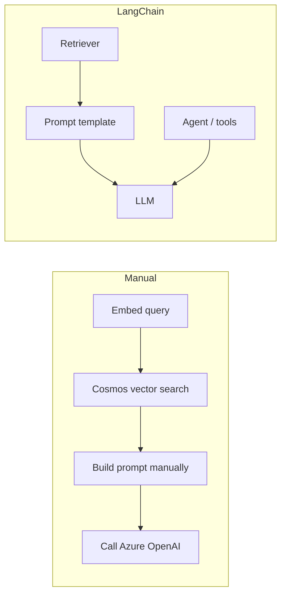

# Manual vs LangChain comparison

## Summary

- Manual RAG is straightforward and explicit.
- LangChain adds structure for more complex workflows and tool orchestration.
- You do not need LangChain for a basic vector retrieval app.
- LangChain becomes valuable when you want reusable orchestration, memory, tool use, and multi-step agents.
