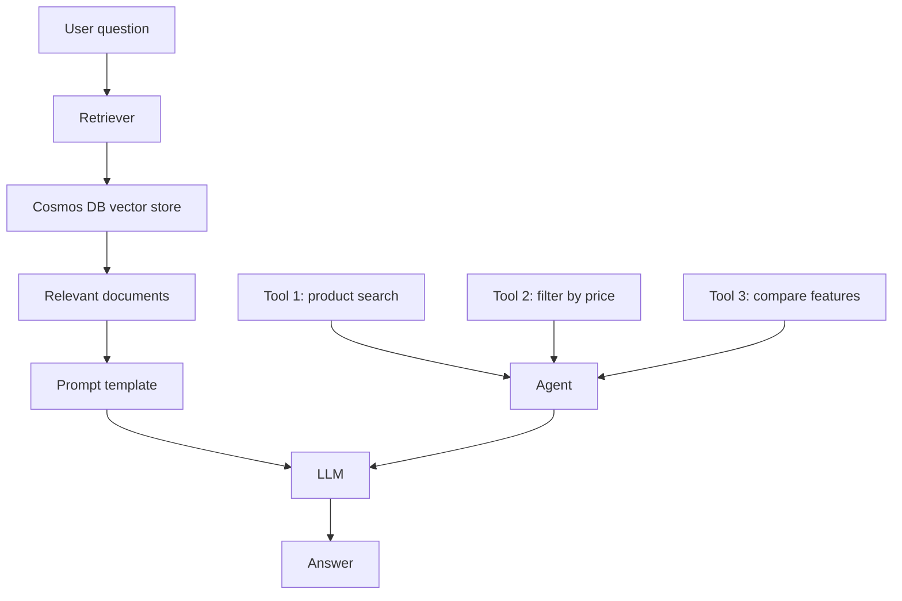

# LangChain RAG flow

This is the higher-level orchestration pattern used by LangChain.

It gives you reusable components such as:
- retrievers
- prompt templates
- LLM wrappers
- tool calling and orchestration

This is useful when the workflow becomes more complex than a single retrieval + answer cycle.
