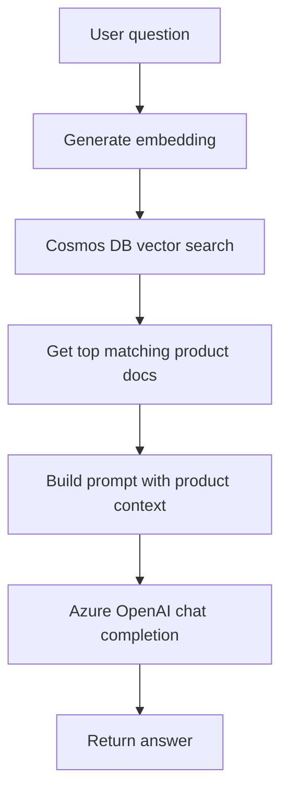

# Manual RAG flow

This is the flow implemented in the direct, no-LangChain notebook.

It is explicit and easy to understand:
- embed the query
- search the vector index
- fetch relevant product records
- inject them into a prompt
- ask the model to answer
